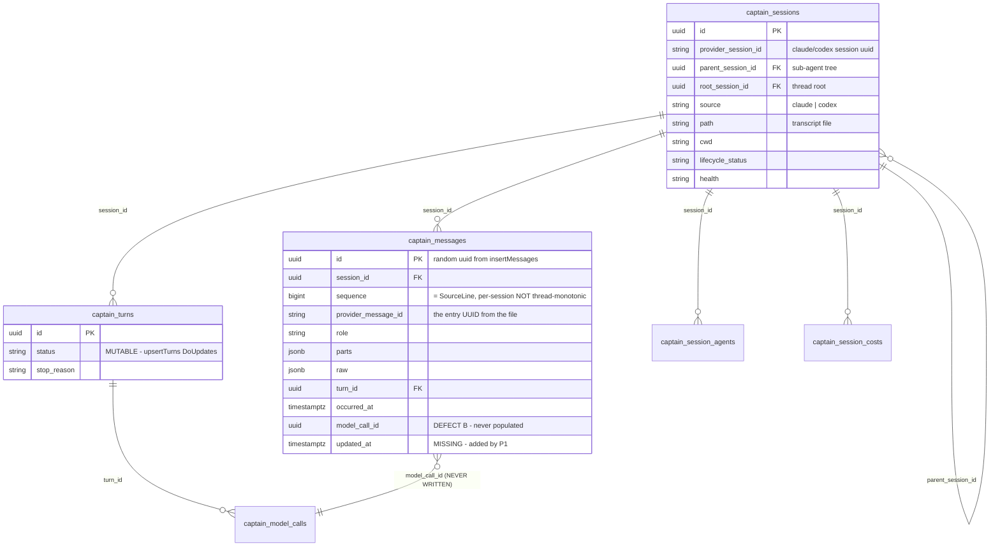
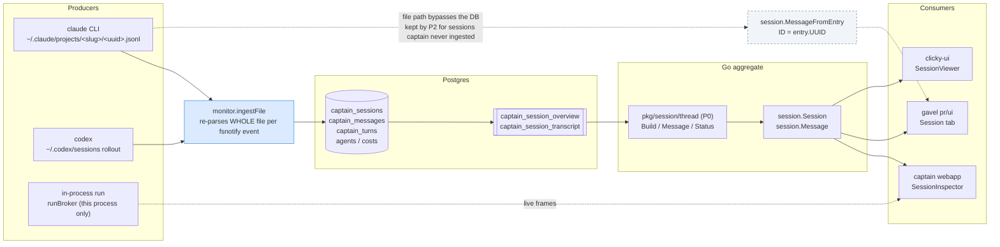

# Contributing to Gavel

Gavel's user documentation and website live in [docs](docs/README.md). Agent-specific rules live in [AGENTS.md](AGENTS.md).

## Development commands

```bash
task build       # build binary (also: make build)
task test        # run all tests
task test:unit   # run unit tests only
task lint        # run linters
task fmt         # format code
task ci          # fmt + lint + test + build
```

## Documentation application

```bash
cd docs
npm install
npm run dev          # http://localhost:5190
npm run build        # type-check + production build into dist/
npm run preview      # serve the built bundle
npm run test         # vitest unit tests
npm run test:e2e     # playwright end-to-end
```

Documentation lives in `docs/content/docs/**/*.mdx`; frontmatter `parent` creates the sidebar hierarchy and `order` sorts siblings. Filenames determine public slugs, including in nested folders. Parents must name an existing doc slug; missing parents, duplicates, and cycles fail validation. Parent pages list their children from the same metadata. Dedicated pages cover every framework, linter, and registered fixture kind. The configuration reference imports the canonical root `gavel.schema.json`, and fixture references use `docs/src/data/fixtures.schema.json`; service-entry definitions are included in the generated fixture bundle. Vite emits schema downloads from the same imports. `SchemaReference` from `@flanksource/clicky-ui/data` renders expandable objects, array items, maps, variants, constraints, and referenced types.

When fixture kinds or command options change, regenerate the fixture bundle from the checked-out source. From the repository root:

```bash
go run ./cmd/gavel fixtures --schema > docs/src/data/fixtures.schema.json
```

Regenerate `gavel.schema.json` using the repository's existing `go generate .` workflow when its configuration schema changes. Do not hand-edit either generated JSON artifact.

The downloadable Markdown, YAML, and JSON smoke fixtures under `public/examples/` are runnable without a database, AI runtime, or network service. From the repository root:

```bash
gavel fixtures docs/public/examples/smoke.fixture.md docs/public/examples/smoke.fixture.yaml docs/public/examples/smoke.fixture.json
```

From `docs/`, run `npm run test` and `npm run build` to validate the documentation loader, schema rendering, TypeScript, and MDX compilation. Use `agent-browser` against the local development or preview server to check navigation, schema links/downloads, and table layout.

Documentation screenshots and screencasts live in `public/media/`. Capture browser UI with `agent-browser`, use a replayed run for stable examples, and inspect the output for machine-specific paths or credentials before linking it from MDX.

## Website environment and deployment

Create `docs/.env.local` (git-ignored) for local development, and set the same keys in Vercel project settings for deploys:

| Variable             | Required | Purpose                                              |
|----------------------|----------|------------------------------------------------------|
| `RESEND_API_KEY`     | yes      | Resend API key — waitlist confirmation email + audience subscribe |
| `RESEND_AUDIENCE_ID` | yes      | Resend audience (mailing list) id for waitlist       |
| `KV_REST_API_URL`    | yes      | Vercel KV URL — waitlist source-of-truth             |
| `KV_REST_API_TOKEN`  | yes      | Vercel KV read/write token                           |

Client code never reads these — they are accessed only from `api/waitlist.ts`.

1. Create a Vercel project; set **Root Directory** to `docs`.
2. Add the env vars above under Project Settings → Environment Variables.
3. Point `gavel.flanksource.com` at the Vercel project via DNS CNAME.
4. Push to the default branch — Vercel builds and deploys automatically.

## PostgreSQL integration testing

Gavel integration tests use `github.com/flanksource/commons-db/dbtest`. With `COMMONS_DB_URL` unset, dbtest starts or reuses a non-durable local PostgreSQL test server on port 7432 under `os.TempDir()/commons-db`. Its process and extracted binaries survive individual tests and subsequent test runs. The normal Go and operating-system temporary-directory configuration determines this location.

Each test leases an empty, isolated database. `Options.Name` labels the lease; omit `Options.DataDir` to share the default server. Open Gavel and Captain through their existing migration entry points using the leased `DSN()`. Migration tests still apply migrations themselves rather than cloning an already migrated schema.

Use `dbtest.ForT(t, dbtest.Options{Name: "gavel_example"})` for standard Go tests, or `dbtest.ForGinkgo(dbtest.Options{Name: "gavel_example"})` in a Ginkgo spec or setup node. Acquire the lease before opening consumer pools and register pool cleanup afterward, so pools close before the lease is released. A Ginkgo lease acquired in `BeforeAll` lasts for its ordered container. Both adapters release their test database automatically; they leave the shared server running. `dbtest.Open` returns a cleanup function for explicitly owned leases.

Run the database integration packages from the Gavel root:

```bash
env -u COMMONS_DB_URL -u COMMONS_DB_CREATE go test -count=1 ./internal/database ./internal/database/todoprojection ./internal/taskhistory ./todos/native ./todos/runtime ./todos/portable
```

Run only the shared-server regressions:

```bash
env -u COMMONS_DB_URL -u COMMONS_DB_CREATE go test ./todos/native -run '^TestNativePlanCreation$' -ginkgo.focus 'shared PostgreSQL test server' -count=1 -v
```

For an external disposable test server, set `COMMONS_DB_URL` to its PostgreSQL connection URL and leave `COMMONS_DB_CREATE` unset or set it to `true`. The account must be able to create and drop test databases. Never use `COMMONS_DB_CREATE=false` for this suite: its migration tests intentionally alter schemas, and that setting uses the supplied database directly. The server must contain only disposable test data.

Application-owned embedded PostgreSQL startup is separate from these leases. Test cleanup releases only its database; it must never stop the shared server or change its configuration.

## Schema generation

`gavel.schema.json` is generated; do not hand-edit it. After changing the config
types, regenerate it:

```bash
go generate .
```

A test (`verify.TestConfigSchema_GoldenMatchesCommitted`) fails if the committed
file is stale, and `verify.TestConfigJSONSchema_CoversStruct` fails if any config
field is left undocumented.

---

## Architecture

- `testrunner/` — the engine. `runner.go`/`streamer.go` drive runs; `parsers/` defines the result
  model (`Test`, `TestSummary`) and rendering; `runners/` are per-tool adapters; `registry.go`,
  `selector.go`, `outline/`, `history/` handle discovery/replay; `tree_builder.go` rolls child status
  up to parents.
- `testrunner/ui/` — the React/Vite test-runner dashboard, published as `@flanksource/gavel` (subpath
  export `./testrunner`). It produces **two** build outputs: `dist/testui.js` (the `//go:embed`-ed
  single bundle) and `dist/lib/*` (the consumable library: `index.js`, `testrunner.js`, `.d.ts`).
- `models/`, `linters/`, `service/`, `serve/`, `status/`, `cmd/`, `ai/`, `docs/` — data model, lint
  adapters, server, status reporting, CLI, AI helpers, and the landing site.

## Test result model

`parsers.Test` carries independent state flags, **not** a single enum — get the precedence right:

- **Pending** = queued / not yet started → static hollow `codicon:circle-large-outline` (gray).
- **Running** = started, unfinished → blue `svg-spinners:ring-resize` spinner. Distinct from Pending
  (before the flag existed the two states read inverted). `Test.Sum()` and the TS
  `sum()`/`sumNonTaskTests()` count Running separately, and `TestSummary` carries it.
- **Warned** (amber) = a soft failure that **never** flips a parent to Failed (a failed child still
  does). In `Test.Sum()` the order is Failed → Warned → Skipped; `tree_builder.go`
  `propagateFailureStatusRecursive` raises `Warned` only under `!Failed`, so amber never masks red. TS
  mirrors this: `statusIcon`/`statusColor`/`testStatus` put the `warned` branch *after* `failed`.
- Prefer the `StatusCounts` helpers (`emptyCounts`/`addCounts`/`countsFromSummary`/`countsFromLeaf`)
  in `testrunner/ui/src/utils.ts` over re-inlining count literals.

## Embedded UI and consumers

- **Both embedded bundles are committed despite being gitignored.** `testrunner/ui/dist/testui.js`
  and `pr/ui/dist/prui.js` are `//go:embed`-ed; since c7f713a1 (first tag v0.0.38) they are tracked so
  a module fetched by tag/SHA satisfies the embed, and `release.yml` rebuilds and `git add -f`s them
  before tagging. `.gitignore` still lists them but has no effect on tracked files, so every local
  `make build` (Taskfile `pr-ui`/`test-ui` regenerate them) shows them modified — that diff is
  build noise: leave it out of feature commits and let release CI refresh it. Refs older than v0.0.38
  lack the bundles and fail with `pattern dist/testui.js: no matching files found`.
- **The frontend has two builds — `build` ≠ `build:lib`.** `pnpm run build` emits only the embed
  bundle (`dist/testui.js`); the consumable library (`dist/lib/testrunner.{js,cjs,d.ts}`, used via the
  `./testrunner` subpath) comes from `pnpm run build:lib` (`vite -c vite.lib.config.ts`, ESM +
  `--mode cjs`). A consumer that links `testrunner/ui` via a `file:` dep and runs its own
  `pnpm install` re-copies the package from *current source state* — if `dist/lib/` is missing the
  store copy ends up dist-less and the consumer's `tsc -b` fails with `Cannot find module
  '@flanksource/gavel/testrunner'`. Always `build:lib` before reinstalling downstream.
- **Multi-run servers compose; `Server` stays single-run.** Concurrent runs are served by
  `testrunner/ui/multiserver.go` `MultiServer`, which holds one ordinary `*Server` per runID:
  `BeginRun(runID, kind) *Server` returns it and `Handler()` strips the leading path segment as the
  runID before delegating to `srv.Handler()`. `Server.Done()` lets a MultiServer evict only finished
  runs (cap + idle-TTL, done-runs only, never a live run). The React `useTestRun` hook takes an
  optional `runId` that scopes every request URL to `${base}/${runId}/api/...`. Keep `Server`
  single-run — don't make it run-keyed.

## Captain lifecycle ownership

The following is the implementation record dated 2026-09-28. Historical verification results describe that checkout; they are not claims about today's build.

Status: implemented in the local Captain and Gavel checkouts, updated 2026-09-28. Focused tests, Captain race tests, both builds, Captain lint, and a read-only dashboard smoke check pass. Broader Gavel tests and lint have failures outside this approval seam; an interactive approval was not created against the existing local TODO database.

### Problem and owner boundary

An attended TODO run previously asked Gavel's dashboard to construct an approval broker before `promptrun.Run` admitted the Captain prompt run. The broker read that run back from Captain's store to recover its approval timeout. When the row had not been admitted yet, dispatch failed with `step run: run <id> was not admitted: captain prompt run not found: <id>`.

The broker has no independent process to start. It is a per-run callback backed by Captain's durable approval rows. Captain already owns run admission, run state, resolved permissions, provider construction, and the run deadline, so Captain should bind this callback after admission. Gavel should opt an attended run into approvals and keep the dashboard's approval list and answer endpoints.

### Implemented API and lifecycle

1. Add `promptrun.Input.Approvals *ApprovalOptions` with `RequestedBy`. `nil` means no Captain approval broker. `Preflight` validates the requester, event sink, provider ownership, and conflicting callback; it permits a missing recording because Gavel previews before admission. `Run` additionally requires `Input.Record` before admitting anything. Invalid combinations fail without creating a prompt run.
2. In `promptrun.Run`, admit the run first. In execution, after the effective run timeout is installed and before building the provider, construct `approval.Broker` with the admitted run's session ID and run ID, recording database, requester, and event notification through `Input.OnEvent`. Parse `Resolved.Spec.Permissions.ApprovalTimeout`; use Captain's existing provider timeout when unspecified. Set the broker's absolute deadline from the effective run context. Install `broker.CanUseTool` in `Input.Config`.
3. Keep the callback bound to this run's broker. Do not add a global callback or use Gavel's `ExecutorContext` to recover identities. The run-level binding propagates cancellation into each callback context and preserves the broker's concurrent request, hold/release, answer, and expiry semantics.
4. Keep Codex's authenticated MCP endpoint alive across turns, but resolve each tool call's context from the active Codex turn through `callertools.Options.ContextForCall`. Permission callbacks and tool handlers receive that turn's values, deadline, and cancellation. A call without an active turn fails explicitly; ending one turn does not cancel the endpoint needed by the next turn. The provider-owned background context controls only the endpoint lifetime.
5. Make Gavel's attended dashboard entry points set the opt-in on the run input. Remove `todos.ApprovalBroker`, the `RunOptions.Broker` and downstream factory plumbing, `stepInput.brokerFactory`, `stepInput.canUseTool`, and the dashboard's `todoApprovalBroker`, `approvalWindow`, `runDeadline`, and `notifyApproval`. Keep the dashboard's durable listing, resolve action, and notification rendering. Route Captain's `EventPermission` fields, including approval ID, tool input, and terminal reason, into the existing transcript and notification seam.
6. In Gavel's recording callback, call `promptrun.DefaultOutcome(result, runErr, stopped)` first. Preserve its cancelled, failed, waiting, and verifier verdict classifications. Apply Gavel's envelope and definition-of-done mapping only after a completed run. Take usage and cost from Captain's final `Result`, avoiding event-sum drift. Keep Gavel's own TODO linking, comments, commit workflow, and envelope rendering.
7. Update the TODO preflight documentation to state that preview validates the approval opt-in but neither admits a run nor constructs its broker. Dispatch binds the broker after admission.

### Verification and order of work

1. Preserve current work in both dirty checkouts. Read scoped diffs before each edit. Add focused failing Ginkgo coverage first. The missing-run path is covered by a Captain test that admits a run, binds approvals, and resolves a fresh-context caller tool against its durable row.
2. Implement Captain's opt-in and test validation before admission, broker identity and timeout, Claude and cmux provider paths, concurrent approvals, deadline, cancellation, and event delivery. Fix Codex caller tools at the shared MCP runtime seam so each call uses the active turn context while the endpoint persists across turns; test callback values, deadline, cancellation, and context resolution when no turn is active.
3. Switch Gavel's attended paths to the opt-in and remove the broker factory. Test attended versus unattended execution, approval notifications and answers, and the reported missing-run failure.
4. Update Gavel's recorded outcome classification. Test cancellation, run errors, questions, failed verification, failed envelope and definition of done, successful completion, and final usage/cost.
5. Run focused Go tests, then `make lint` and `make build` in each changed repository. Check local dashboard rendering with agent-browser. Use an isolated scripted provider for a full interactive approval smoke, since the available local dashboard uses an existing TODO database. Report unrelated gate failures separately from the changed seams.

### Historical verification recorded

- Captain `go test ./pkg/promptrun ./pkg/ai/approval -count=1`, `make lint`, and `make build` passed. The new binding test admits a run, resolves an approval raised with `context.Background()`, then cancels a second approval through the run context.
- The Codex context follow-up passed `go test ./pkg/ai/callertools ./pkg/ai/provider`, `go test -race ./pkg/ai/callertools ./pkg/ai/provider`, `make lint`, and `make build` in Captain. Focused Ginkgo tests verify per-turn values and deadlines, approval cancellation, and that Codex supplies no call context when no turn is active.
- Gavel focused lifecycle, entity, and dashboard approval tests passed, and `make build` passed. The new lifecycle test checks approval ID, input, and expiry reason in the transcript; the outcome tests cover cancellation, waiting, and final usage/cost.
- A newly built Gavel dashboard served `/todos/f1e27b11?project=gavel&tab=session` in agent-browser. Its session tab rendered successfully. No run or approval was started against the existing local database.
- Broader Gavel tests still fail in runtime-default composition, API-mode sandbox preflight, and unrelated entity catalog routes. `make lint` reports unused declarations in untouched `pr/ui/chat.go` and `pr/ui/entity_routes.go`, then `go mod tidy` cannot find `captain/pkg/plans` and `captain/pkg/sessiontree` in the published Captain version.

No schema or HTTP API change was made. The new Captain opt-in is a typed Go API used by recorded, attended runs.

## Azure provider implementation record

Historical completion record; current user behavior is documented in the [Azure guide](docs/content/docs/azure-devops-pr-support.mdx). Later PR dashboard capabilities may extend the original implementation scope.

- Move shared result types into `pr/model` and creation orchestration into `pr/create`; update existing callers without compatibility aliases.
- Introduce a shared provider seam for repository resolution, PR lookup, status, open-PR lookup, default branch, and creation.
- Keep GitHub behavior, artifact enrichment, polling, filters, rendering, and creation base precedence. Preserve native Azure timeline UUIDs and explicit build/check associations.
- Scope Azure builds to the PR repository and current revision; select the latest attempt per pipeline. Fetch failed timeline logs only when requested.
- Derive Azure merge readiness from merge status and blocking policy evaluations. Distinguish ready, conflicting, blocked, pending, and unknown; surface reasons.
- Reuse isolated worktrees, ordered cherry-picks, AI-generated content, draft/base options, and conflict recovery across CLI, commit-push, and project branch-PR creation.
- Fail unsupported Azure review, AI-repair, and auto-merge flags before side effects. Dashboard listing, close/merge actions, and self-hosted Server are excluded.

### Historical verification

Focused Ginkgo coverage includes URL/remote parsing, authentication precedence/refresh, current-build selection, UUID filters, timeline ordering, log tails, merge policies, API errors, and polling. Creation tests use local HTTP and bare Git servers. The verifier runs affected GitHub, watcher, commit, creation, and project API tests, followed by `make lint` and `make build`.

The executable verifier is [fixtures/azure-devops-pr.fixture.md](fixtures/azure-devops-pr.fixture.md). Run it with `gavel fixtures fixtures/azure-devops-pr.fixture.md`. It exercises the provider with local HTTP services and bare Git repositories; it does not create a live PR.

TODO `1c5fa474-edda-4a3c-b40b-ec51e6e86015` passed `gavel todos check`: all eight definition-of-done checks passed, including `make lint` and `make build`.

The full commit suite has four unrelated model-alias expectation failures. Concurrent external Git operations left unresolved conflicts in `go.work.sum` and `pr/ui/dist/prui.js`; these are preserved outside the Azure changes.

## Session architecture snapshot

The following planning snapshot predates session unification. Defects, source line numbers, and proposed work describe that snapshot and require source verification before implementation. See the [rendered diagram](docs/public/diagrams/SessionDataModel.html) and [diagram source](docs/diagrams/SessionDataModel.tsx).

How a session travels from an agent process to the gavel Session tab, across captain's storage and projection layers.

Written while planning the session unification (todos P0 `6a897b78`, P1 `ff383651`, P2 `8f1fb6e9`, P3 `03394394`, P5 `b20f56f5`). Two defects marked below are not yet covered by any of them.

### Entities



`captain_messages` is append-only (`insertMessages` uses `OnConflict{DoNothing}`), while `captain_turns` is upserted in place. That asymmetry is why turn enrichment has to travel on its own frame rather than resending messages — and why P1 adds `updated_at` before anything trusts a cursor.

### Paths



The solid path is what P0–P2 unify. The dashed path is the raw JSONL tail that P2 deliberately keeps in gavel (`streamSessionLog`) for sessions captain never ingested — so both branches stay live, which is exactly why message identity has to agree across them.

### Defect A — message identity splits by path

The same logical message carries two different IDs depending on which path served it:

| Path | `Message.ID` source | Where |
|---|---|---|
| File | `entry.UUID` | `pkg/session/build_messages.go:116` |
| Ingest | stores that same UUID as `provider_message_id` | `pkg/monitor/ingest.go:232` |
| DB (gavel today) | `row.id` — the random `uuid.New()` from `insertMessages` | `pr/ui/todo_session.go:~525` |

P0 introduces `thread.Message(row, owner)` to replace `captainTranscriptMessage` but does not specify which ID it emits. If it copies today's behavior, **P2's `id:` = cursor SSE resume is built on an identity that changes when the backend changes**, so client dedupe breaks precisely on reconnect.

Fix: `Message.ID` should come from `provider_message_id`, falling back to the row UUID only when NULL — and the fallback reported rather than silent.

### Defect B — three permanently-null columns

`messageRecord` (`pkg/database/session_ingest_store.go:96-108`) has no `ModelCallID` field, and `model_call_id` has zero writes anywhere in `pkg/`. But `migrations/61_view_session_transcript.sql:27` joins `captain_model_calls ON c.id = m.model_call_id`, so `model`, `backend` and `effort` are permanently NULL on the transcript projection.

P0's collection endpoint would ship three fields that can never be populated, and P5's drift tests would then lock them in. Either wire `ModelCallID` at ingest or drop them from the projection.

### Ordering and cursors

`captain_session_transcript` orders by `occurred_at NULLS LAST, session_id, sequence`. Two consequences:

- `sequence` is per-session `SourceLine` (`pkg/monitor/ingest.go:180`), **not** thread-monotonic, so it cannot serve as a cursor alone. P1's cursor is `base64("<occurred_at RFC3339Nano>|<session_id>|<sequence>")`.
- `occurred_at` may be NULL, and a late-arriving sub-agent message can interleave *before* rows already delivered — which is why exactly-once resume needs the full tuple rather than a single high-water mark.

### Role coverage

The two read paths do not agree on which roles they return:

- **DB projection** — role-complete (user, assistant, tool_result).
- **File tail** — assistant-only. `history.SessionEntry.Events()` (`pkg/ai/history/session_stream.go:54-57`) hard-returns nil for `Type != "assistant"`, with no opt-out.

That filter is correct for its one caller — cmux's `sessionTailer` uses it as a turn-completion detector, where user rows are noise. The fix is for the unified read path to use `session.MessageFromEntry` instead of `ParseSessionEvents`, so file-tail and file-batch produce identical messages by construction. Until then, one endpoint returns different content depending on which backend answered.

## Embedded UI development servers

- `--dev` serves a UI from its Vite dev server instead of the bundle embedded in the binary, so source edits show up on a browser refresh. `gavel test --ui --dev`, `gavel fixtures --ui --dev` and `gavel ui serve --dev` start `pnpm dev` in `testrunner/ui` on port 5275, and `gavel pr list --ui --dev` / `gavel serve --dev` do the same in `pr/ui` on port 5273. A dev server already running on the port is reused. The Go server keeps every `/api/*` route and proxies everything else to Vite. It needs a source checkout of gavel, run from inside it, with the UI's `pnpm install` done.
- In dev mode, `@flanksource/clicky-ui` resolves from the sibling checkout's source (`../clicky-ui/packages/ui/src`) when that checkout exists, so clicky-ui edits show up on a refresh too. The aliases follow the sibling's `package.json` exports. Its stylesheets come from the sibling's `dist/`, so build it once (`task clicky-ui:build`). `GAVEL_UI_WATCH_CLICKY=0` keeps resolving the sibling's source but stops watching it.
